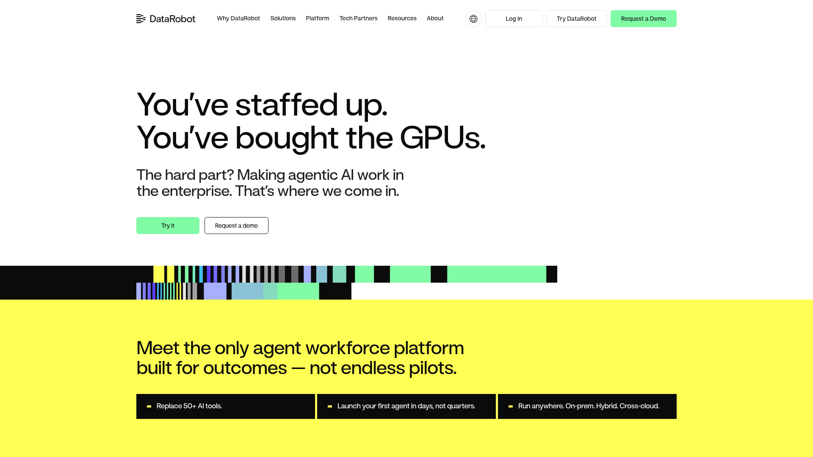

# DESIGN.md: DataRobot

## Source
- URL: https://www.datarobot.com/
- Capture date: 2026-06-05
- Evidence: `branding+images` scrape (17KB JSON), `screenshot` format (PNG), page markdown

## Reference Screenshot


Use this screenshot as the visual source of truth for layout, hierarchy, density, and feel. Tokens below describe the same page in machine-readable form.

---

## Design Summary

DataRobot uses a high-contrast, editorial enterprise aesthetic. The palette leads with near-black (`#0B0B0B`) and clean white, punctuated by a vivid **mint green** CTA accent (`#81FBA5`) and bold **bright yellow** section backgrounds. Typography is dominated by **STK Miso** — an ultra-wide, heavy display face at massive sizes — paired with **DM Sans** for readable body copy. The overall feel is bold, direct, and confident: large typographic statements, minimal decoration, strong section-level color blocking (white → yellow → black). No gradients; no shadows; sharp edges on secondary buttons.

---

## Design Tokens

### Colors

| Role | Hex | Notes |
|---|---|---|
| Primary CTA / Accent | `#81FBA5` | Mint green — primary button fill |
| Background (default) | `#FFFFFF` | White, main page background |
| Background (near-white) | `#F9FAFB` | Off-white on some sections (inferred) |
| Background (yellow) | `#F5FF00` | Bright yellow section — confirmed in screenshot |
| Background (dark) | `#0B0B0B` | Near-black — feature tiles, dark sections |
| Text primary | `#0B0B0B` | Headlines and body on light backgrounds |
| Text on dark | `#FFFFFF` | White text on dark/black sections |
| Text link | `#A6B0FF` | Muted periwinkle — link color |
| Secondary / Purple | `#5C41FF` | Violet accent, brand secondary |
| Secondary button text | `#231F20` | Very dark on white secondary button |
| Theme / chrome | `#FFFFFF` | Browser `theme-color` |

### Typography

| Element | Family | Weight | Size | Notes |
|---|---|---|---|---|
| Hero H1 | STK Miso | Black/900 | ~78px | Ultra-wide display, tight leading |
| H2 / Section headline | STK Miso | Bold/700 | ~36px | Used in yellow and dark sections |
| Body / UI | DM Sans | Regular/400–500 | 16–18px | Clean neutral sans-serif |
| Nav links | DM Sans | Medium/500 | 15px | |
| Fallback (heading) | `"STK Miso", "DM Sans", sans-serif` | | |
| Fallback (body) | `"DM Sans", "Roboto", "Noto Sans JP", sans-serif` | | Includes JP for i18n |

> **STK Miso is a custom/licensed typeface.** Open-source alternatives: **Bebas Neue** or **Barlow Condensed Black** approximate the weight and width.

### Spacing and Layout

| Token | Value | Notes |
|---|---|---|
| Base unit | 4px | All spacing in 4px increments |
| Container max-width | ~1200–1440px | Inferred from screenshot |
| Section vertical padding | ~80–120px | Generous vertical rhythm |
| Hero top padding | ~80px | Below nav |
| Border radius (primary button) | `6px` | Slightly rounded |
| Border radius (secondary button) | `0px` | Square/sharp — no radius |
| Grid gap (3-col) | ~24–32px | Feature tile row |

---

## Components

### Navigation
- White background, full-width
- **Left**: Stacked grid logomark + "DataRobot" wordmark in `#0B0B0B`
- **Center**: Text links — Why DataRobot, Solutions, Platform, Tech Partners, Resources, About
- **Right**: Globe (language selector), "Log In" ghost, "Try DataRobot" secondary, **"Request a Demo"** primary (mint `#81FBA5`)
- Language: US / JP

### Buttons

**Primary (Mint)**
```css
background: #81FBA5;
color: #0B0B0B;
border-radius: 6px;
border: none;
padding: 12px 24px;
font-family: "DM Sans";
font-weight: 500;
```

**Secondary (Outlined, Sharp)**
```css
background: #FFFFFF;
color: #231F20;
border-radius: 0px;       /* no radius — sharp corners */
border: 1.5px solid #231F20;
padding: 12px 24px;
font-family: "DM Sans";
font-weight: 500;
```

**CTA Pattern**: Primary (filled mint) + Secondary (outlined square) side by side.

### Hero Section
- White background
- H1 in STK Miso: ~78px, two-line typographic statement, tight leading
- Subhead in DM Sans: 18–20px, muted, 2 lines
- CTA pair below (mint + outlined)
- Below hero: full-width **decorative bar pattern** — vertical colored stripes in purple, teal, mint, black (`pattern-1row-c2.svg`)

### Yellow Value Prop Section
- Background: bright yellow `#F5FF00`
- H2 headline in black, large, multi-line: "Meet the only agent workforce platform built for outcomes — not endless pilots."
- Below: 3-column tile grid
  - Each tile: `#0B0B0B` background, white text, bullet prefix, single declarative line
  - "Replace 50+ AI tools." / "Launch your first agent in days, not quarters." / "Run anywhere. On-prem. Hybrid. Cross-cloud."

### Product Feature Section
- Build / Operate / Govern tab structure
- Product UI screenshot at right, description at left
- Images: `homepage-build.jpg`, `homepage-operate.jpg`, `homepage-govern.jpg`

### Validation / Proof Section
- 3 cards with screenshots: `homepage-validation-1/2/3.webp`
- YouTube video embeds
- Analyst/partner logo strip: Forbes, Fortune, SAP, NVIDIA, Gartner, IDC (flat SVG logos)

### Footer
- Dark background `#0B0B0B`, white text

---

## Page Patterns

Section order (top → bottom):

1. **Nav** — white, sticky
2. **Hero** — white, left-aligned text, mint + outlined CTAs, decorative stripe pattern
3. **Value prop** — yellow bg, bold H2 + 3 dark tiles
4. **Product features** — tabbed (Build / Operate / Govern) with product screenshots
5. **Validation** — proof images + YouTube
6. **Social proof** — analyst/partner logo strip
7. **Footer** — dark (`#0B0B0B`)

---

## Content Style

- **Headlines**: Bold, direct statements addressing the user's current state. ("You've staffed up. You've bought the GPUs.")
- **Subtext**: Problem-first framing → solution handoff
- **CTAs**: "Try it" (low friction) / "Request a demo" (sales-led)
- **Tone**: Modern, high-energy enterprise. Never fluffy. Confident.
- **Density**: Low — large type, short lines, heavy whitespace
- **Audience**: Enterprise buyers, AI practitioners, IT leaders

---

## Agent Build Instructions

To create a new site in DataRobot's visual style:

1. **Fonts**: Import `DM Sans` (Google Fonts). Use `Bebas Neue` or `Barlow Condensed Black` as open-source STK Miso substitute.

2. **CSS variables**:
```css
:root {
  --color-mint:   #81FBA5;
  --color-yellow: #F5FF00;
  --color-black:  #0B0B0B;
  --color-white:  #FFFFFF;
  --color-purple: #5C41FF;
  --color-link:   #A6B0FF;
}
```

3. **Layout**: Full-width sections. `max-width: 1280px; margin: 0 auto; padding: 0 48px`. Section padding `py-20 md:py-32`.

4. **Hero**: Left-aligned text, ~55% width, display heading 5–6rem, 2-line subtext, then CTA pair.

5. **Buttons**:
   - Primary: mint fill + `border-radius: 6px` + dark text
   - Secondary: white + `border: 1.5px solid #231F20` + **`border-radius: 0`** (sharp)

6. **Section backgrounds**: Alternate `#FFFFFF` → `#F5FF00` → `#0B0B0B`. No gradients.

7. **Pattern element**: Full-width horizontal band of vertical stripes in varying widths + brand colors between hero and next section.

8. **Typography scale**:
   - H1: display font, 72–96px, weight 900
   - H2: display font, 36–48px, weight 700
   - Body: DM Sans, 16–18px, weight 400

9. **Dark tile grid**: 3-column equal-width tiles on `#0B0B0B`, white text, left-aligned bullet prefix (`—`), no border, no radius.

---

## Asset References

| Asset | URL |
|---|---|
| Logo (SVG, inline) | `branding.images.logo` in `.firecrawl/datarobot-branding.json` |
| Favicon | `https://www.datarobot.com/wp-content/uploads/2024/11/datarobot-favicon-512px-300x300.png` |
| OG Image | `https://www.datarobot.com/wp-content/uploads/2024/11/refresh-2024-featured-image.jpg` |
| Decorative pattern | `https://www.datarobot.com/wp-content/themes/datarobot6/assets/images/static/pattern-1row-c2.svg` |
| Feature: Build | `https://www.datarobot.com/wp-content/uploads/2025/07/homepage-build.jpg` |
| Feature: Operate | `https://www.datarobot.com/wp-content/uploads/2025/07/homepage-operate.jpg` |
| Feature: Govern | `https://www.datarobot.com/wp-content/uploads/2025/07/homepage-govern.jpg` |

> These are third-party assets. Do not redistribute. Reference only for design analysis.

---

## Rerun Inputs
```yaml
workflow: firecrawl-website-design-clone
source_url: https://www.datarobot.com/
target_stack: any
output: DESIGN.md
```
