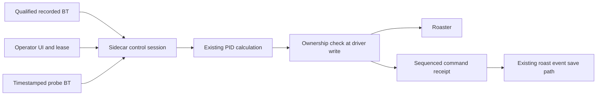

# FSD architecture notes

> Historical source investigation at 5c4649e8, before FSD-01 fixes. Line references describe that baseline. See [current progress](README.md) for completed changes.

## Overview

Proposed FSD follows a recorded BT curve by adjusting Gas under operator supervision. V1 keeps Charge gas and pre-TP operation manual. Closed loop requires explicit eligibility for both live and reference TP. Charge remains the time origin. Doors, fan, drum, pre-TP feedforward, and unattended operation are excluded.

Existing software PID accepts a temperature target and computes duty. Its runner owns hold and fault behavior. Curve timing, reference qualification, operator leases, and exclusive ownership require new contracts. See [pid.py:34](../../../src-tauri/sidecar/pid.py:34) and [pid_runner.py:53](../../../src-tauri/sidecar/pid_runner.py:53).

## Key concepts

The proposed immutable target contains recorded probe BT in Celsius, Charge-relative timestamps, processing provenance, and reference TP eligibility. Display curves cannot supply this contract. `useResolvedProfileCurve` explicitly falls back to synthetic points at [queries.ts:135](../../../src/entities/roast-profile/queries.ts:135).

The proposed control session contains a sidecar clock origin, connection generation, heater owner, lease expiry, and command sequence. Model the Domain motivates this explicit state instead of independent flags.

## How it works

The view composes profile selection with machine control without importing sibling features into each other. Proposed activation freezes an eligible target and obtains exclusive heater ownership. A sidecar loop evaluates the Charge-relative target against live PV and calls the existing PID calculation.

Current `_pv_snapshot` stamps retrieval time at [manager.py:1072](../../../src-tauri/sidecar/manager.py:1072). It must retain acquisition time. The loop sleeps before awaiting work at [manager.py:1147](../../../src-tauri/sidecar/manager.py:1147), so it is not fixed wall-clock cadence. Repeated cached samples must not count as new measurements.

Manual takeover, lease expiry, Drop, and target completion must revoke ownership before further automatic writes. Ordinary commands currently bypass the retry ownership predicate at [manager.py:1018](../../../src-tauri/sidecar/manager.py:1018). S7 checks connection identity under its lock, but needs the control generation for every command at [s7.py:557](../../../src-tauri/sidecar/adapters/s7.py:557).

Applied receipts should extend the existing shared control record and serialization path, with bounded retention and explicit gaps. See [roast.ts:6](../../../src/shared/types/roast.ts:6) and [serialize-roast-events.ts:18](../../../src/features/active-roast/lib/serialize-roast-events.ts:18). Receipt success proves an applied command, not delivered heat.

## Where things live

The proposed four local commit units follow Sequence Work into Verifiable Units. FSD01 proves timestamps and ownership. FSD02 adds qualified targets and virtual-only sessions. FSD03 adds reachable controls, receipts, and isolated browser tests. FSD04 records supervised commissioning for one physical machine and qualified batch conditions. No push or PR is authorized.

## Gotchas

Filter equivalence needs explicit seed, sampling cadence, warmup, missing-sample handling, and version. Equal EMA coefficients alone are insufficient. Backdated Charge needs a frozen origin policy. Leases need a duration and renewal authority that detects an unusable operator UI. `ActiveRoastRuntime` survives the view boundary at [App.tsx:319](../../../src/App.tsx:319).

Cancelling an async task cannot retract an executor write already in progress. Define takeover acknowledgement after a write barrier and report uncertain outcomes.

Disconnect attempts logical zero at [manager.py:604](../../../src-tauri/sidecar/manager.py:604), contradicting [sidecar-api.md:595](../../../docs/sidecar-api.md:595). Classic Giesen maps logical zero to raw one. Physical gas shutdown remains the panel and interlocks' responsibility at [roaster_registry.py:215](../../../src-tauri/sidecar/roaster_registry.py:215). A dead sidecar cannot expire its lease.

Browser tests must fail on port collisions. Existing setup reuses port 9999 at [global-setup.ts:14](../../../e2e/global-setup.ts:14), and `pnpm dev` kills its listener at [package.json:8](../../../package.json:8). Neither behavior is acceptable near a connected machine.

No hardware or controller tuning was checked. Physical qualification remains required.
