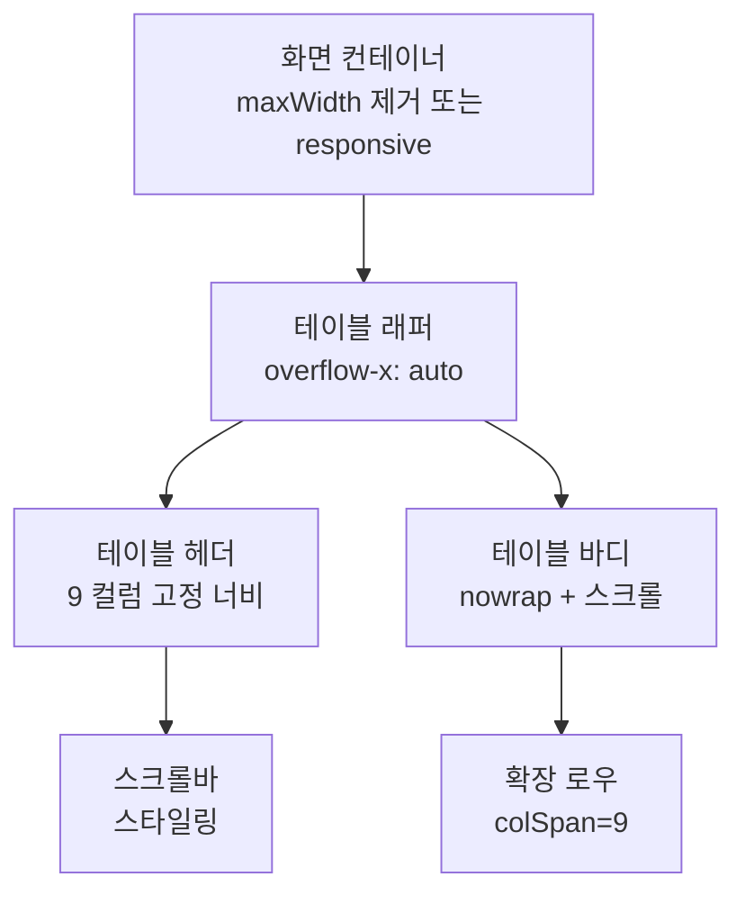

## Roast History 세션 테이블 가로 잘림 문제 개선 계획

### 1. 문제 분석

- **원인**:
    - [`src/views/History.tsx`](src/views/History.tsx): 테이블 컨테이너에 `maxWidth: 1100` 설정으로 작은 화면에서 내용이 잘림.
    - 테이블 `width: '100%'`, 각 `td/th`에 `whiteSpace: 'nowrap'` 적용으로 텍스트 줄바꿈 없음.
    - 컬럼 수 많음 (Date, Bean, Profile, Weight, Drop, Duration, Dev, Loss, Level) → 총 너비 초과.
    - 모바일/작은 창에서 horizontal overflow 처리 없음.

- **영향**: 가로 스크롤 없어 내용 잘림, UX 저하.

### 2. 개선 전략

#### 옵션 1: Horizontal Scroll (권장 - 빠른 구현)

- 테이블 래퍼 div에 `overflow-x: auto; white-space: nowrap;` 추가.
- 테이블에 `min-width: 900px;` (컬럼 최소 너비 확보).
- 스크롤바 스타일링으로 자연스럽게.

#### 옵션 2: Responsive 컬럼 숨김

- 미디어 쿼리 또는 CSS-in-JS로 작은 화면에서 저우선순위 컬럼 (Dev, Loss 등) 숨김.
- JS로 window resize 감지해 컬럼 토글.

#### 옵션 3: 컬럼 너비 최적화 + 줄바꿈 허용

- `table-layout: fixed;`, 각 컬럼 고정 너비 (e.g., Bean 20%, Date 10% 등).
- 일부 컬럼 `whiteSpace: normal;` 허용.

**선택: 옵션 1 + 3 조합 (스크롤 + 최적화)** – 배치 데이터 특성상 모든 컬럼 필요.

### 3. 구현 단계 (Code 모드용)

```
- 테이블 래퍼 스타일 수정: overflow-x: auto; -webkit-overflow-scrolling: touch;
- 테이블 min-width: 1000px; table-layout: fixed;
- th/td padding 줄이고, 폰트사이즈 미세 조정.
- 데스크톱/모바일 테스트.
```

### 4. 예상 레이아웃 (Mermaid)



### 5. 테스트 체크리스트

- 창 너비 1200px 이상: 정상.
- 800px ~ 1200px: 가로 스크롤 등장.
- 600px 이하: 주요 컬럼 우선 (Bean, Date, Level).
- 터치 디바이스: smooth scroll.

이 계획으로 진행하시겠습니까?
